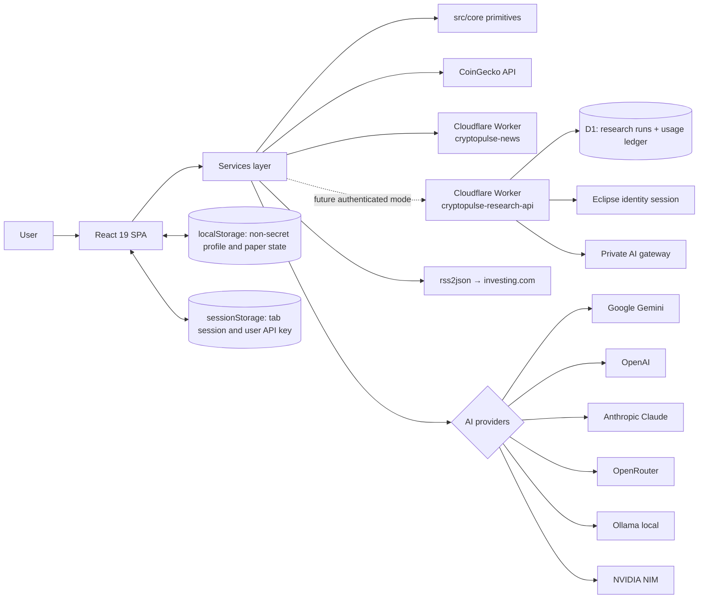
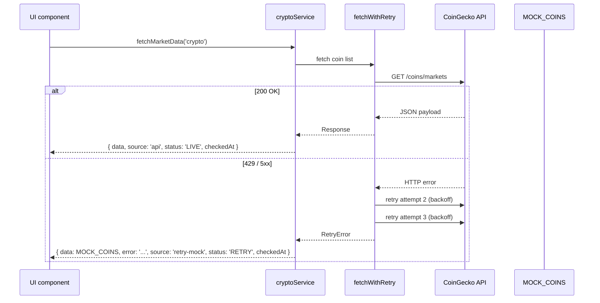
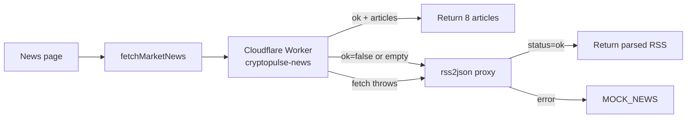

# Architecture

CryptoPulse Research Lab is a **client-first** research SPA with an explicit,
separately deployed server boundary for commercial capabilities. The default
release still keeps state in browser storage; `workers/research-api/` is a
fail-closed reference for real accounts, shared research and server AI requests
and is not enabled by default.

This document describes the three layers that matter for understanding how data flows through the app, and the engineering decisions that shape them.

---

## 1. Layer overview



### Layer responsibilities

| Layer | What lives here | What does **not** |
|---|---|---|
| **UI** (`src/components`, `src/pages`) | React 19 + Tailwind + Recharts components, routing, visuals | No direct `fetch()`, no business rules, no mutation of storage |
| **Services** (`src/services`) | API calls, mock fallbacks, provider dispatch, business logic | No JSX, no React hooks except within custom hooks |
| **Core** (`src/core`) | Reusable primitives with zero UI/business coupling (`retry.ts`) | No imports from `services/` or `components/` |

The core layer is deliberately small — it's where code goes when we discover it's reusable **across projects**, not just inside CryptoPulse.

---

## 2. Market data pipeline



### Source tagging

Every `ServiceResponse<T>` carries a required `source: DataSource` field:

| source | Meaning | Typical UI badge |
|---|---|---|
| `'api'` | Real data from the upstream API on the current call | 🟢 LIVE |
| `'cache'` | Verified local/provider cache (reserved for the cache layer) | 🔵 CACHED |
| `'mock'` | Built-in static data (forex/futures have no real API yet) | ⚪ MOCK |
| `'retry-mock'` | Real API was tried, retry exhausted, fell back to mocks | 🟡 RETRY |
| `'unavailable-mock'` | Upstream returned a non-retryable error; mock data is shown explicitly | 🔴 UNAVAILABLE |
| `'mixed'` | Live crypto data is combined with explicit demo rows for another market class | 🟡 MIXED SOURCES |

Why this matters:
- Previously, callers couldn't distinguish "live BTC price" from "cached mock fallback" — both looked the same. That's a classic silent-fallback antipattern.
- With `source`, `status` and `checkedAt`, the UI can render a badge, tests can assert deterministically, and telemetry can report real API availability separately from cache or demo data.

### Retry strategy

`fetchWithRetry` wraps `fetch()` with `src/core/retry.ts`:

- **Max attempts:** 3
- **Backoff:** exponential, 500ms → 1000ms → 2000ms, capped at 4000ms
- **Jitter:** ±50% to avoid thundering-herd on shared rate limits
- **Retryable:** HTTP 408, 425, 429, 500, 502, 503, 504
- **Non-retryable:** everything else (passes through to the caller's fallback branch)

The `src/core/retry.ts` module is **byte-identical** to the copy in [Eclipse Valhalla](https://github.com/PavelHopson/Eclipse-Valhalla). This is intentional: both projects will eventually pull it from a shared npm package ([`@pavelhopson/retry-http`](https://github.com/PavelHopson) — planned). Zero-delta port proves the module was designed as standalone from day one.

---

## 3. AI provider pipeline

```mermaid
flowchart TD
    Entry[generateCoinAnalysis] --> Config[getAIConfig]
    Config --> Profile{User profile<br/>has AI config?}
    Profile -->|yes| UseProfile[Use profile.preferences.ai]
    Profile -->|no| NoKey[No client key; show setup state]
    UseProfile --> Dispatch[PROVIDERS[config.provider]]
    NoKey --> Dispatch
    Dispatch --> G[callGemini]
    Dispatch --> O[callOpenAI]
    Dispatch --> A[callAnthropic]
    Dispatch --> R[callOpenRouter]
    Dispatch --> L[callOllama]
    Dispatch --> N[callNvidia]
```

Provider keys are session-scoped in client mode. The browser bundle has no
`GEMINI_API_KEY` fallback. The `aiGateway` boundary keeps client adapters
separate from the server transport, strips credentials from server payloads,
uses a credentialed session/CSRF boundary for future server mode, rejects
untrusted endpoints, and returns redacted errors.

### Supported providers

| Provider | Endpoint | Auth | Availability | Notes |
|---|---|---|---|---|
| **Google Gemini** | via `@google/genai` SDK | API key | Depends on account | Default fallback; loads SDK dynamically |
| **OpenAI** | `api.openai.com/v1/chat/completions` | Bearer | No | Standard Chat Completions |
| **Anthropic Claude** | `api.anthropic.com/v1/messages` | `x-api-key` | No | Requires `anthropic-dangerous-direct-browser-access` |
| **OpenRouter** | `openrouter.ai/api/v1/chat/completions` | Bearer | Partial | Routes through 100+ models; requires `HTTP-Referer` |
| **Ollama (local)** | `localhost:11434/api/generate` | None | Fully local | Appends uncensored-mode preamble for abliterated/huihui models |
| **NVIDIA NIM** | `integrate.api.nvidia.com/v1/chat/completions` | Bearer | Depends on account | OpenAI-compatible format; 5 preset models |

The `PROVIDERS: Record<AIProvider, ...>` map is an **exhaustive TypeScript record**. Adding a new provider to the `AIProvider` union forces a compile error until you register its handler — this caught the NVIDIA NIM addition automatically.

### Error propagation

- A provider handler **throws** → gateway redacts provider details → UI shows a safe retry/setup message
- Missing API key (non-ollama) → short-circuit with "AI не настроен" message before any network call
- NVIDIA NIM reads both `error.message` and `detail` fields (endpoint varies by model); provider errors are redacted before they reach the UI

---

## 4. News pipeline



Three-tier fallback: **Worker → RSS proxy → in-memory mocks**. Each tier is tested against its happy path, fall-through, and throw paths.

- **Worker** (primary): custom Cloudflare Worker at `cryptopulse-news.hopsintoxin.workers.dev/crypto` parses CoinTelegraph + CoinDesk + investing.com in real time. Quotas and availability depend on the deployed Cloudflare plan.
- **RSS proxy** (fallback): `api.rss2json.com` over investing.com RU RSS, with HTML-stripping and relative date formatting (`N мин назад`, `N ч назад`, or localized short date).
- **Mocks** (last-resort): two hardcoded stories so the UI never shows an empty state.

---

## 5. Storage

The default client mode persists local research state in the browser:

| Key | Purpose |
|---|---|
| `localStorage['cryptopulse_users_v2']` | Local profiles, salted PBKDF2 password credential and non-secret AI provider/model settings. Plaintext passwords and API keys are removed during bootstrap migration |
| `localStorage['cryptopulse_portfolio']` | Legacy paper-position compatibility; no live order flow |
| `localStorage['cryptopulse_favorites']` | Favorite asset IDs |
| `localStorage['cryptopulse_strategy_history_v1']` | Up to ten locally saved Strategy Lab receipts and results |
| `localStorage['cryptopulse_system_config']` | Admin overrides for volatility/bias (dev panel only) |
| `sessionStorage['cryptopulse_session_id']` | Current tab-local profile session; removed when the tab session closes |
| `sessionStorage['cryptopulse_ai_secrets_v1']` | User-supplied AI key for the current tab only; never written to persistent profile storage |

There is deliberately **no server-side user database in the default client
mode**. Account creation is local-only. Passwords are protected with Web
Crypto PBKDF2-HMAC-SHA256, a per-user random salt and 600,000 iterations; this
prevents plaintext persistence but does **not** turn the demo profile into real
server-backed authentication. The separate Research API can own production
sessions, D1 research runs and usage ledger once its identity and bindings are
configured. A bootstrap migration converts legacy plaintext values and moves
legacy session/API-key data to `sessionStorage` before React renders.

---

## 6. Testing strategy

Focused tests cover the services, Strategy Lab and security-sensitive local state:

| File | Tests | What it locks down |
|---|---:|---|
| `src/services/cryptoService.test.ts` | — | Source tagging, retry paths, unavailable responses and fail-closed trust checks |
| `src/services/aiService.test.ts` | — | Provider handlers, prompt construction and redacted error paths |
| `src/services/aiGateway.test.ts` | — | Client/server boundary, endpoint validation and secret-free payloads |
| `src/services/strategyLab.test.ts` | — | Paper-only boundary, execution costs, walk-forward and Monte Carlo invariants |
| `src/services/strategyCsvImport.test.ts` | — | CSV limits, quoting, dates, prices and ordering |
| `src/services/strategyExport.test.ts` | — | Deterministic Markdown, receipt and UTF-8 CSV exports |
| `src/services/userService.test.ts` | — | Local credentials, migration and session-only secrets |

**Mocking patterns:**
- `vi.stubGlobal('fetch', fetchMock)` for HTTP isolation
- `vi.mock('./userService', ...)` with mutable `profileHolder` so each test can swap config
- `vi.mock('@google/genai', { GoogleGenAI: class { ... } })` — plain class, because `vi.fn()` isn't a real constructor
- `vi.mock('./adminService', ...)` to pin `applyLiveJitter` determinism

Tests use real timers where retry behaviour is under test. CI must run the full Vitest suite once dependencies are installed; the local release worktree currently has no `node_modules`.

---

## 7. Deployment

- **Hosting:** Cloudflare Pages at `cryptopulse-1d0.pages.dev`
- **Build:** `npm run build` — Vite production build, outputs to `dist/`
- **CI:** `.github/workflows/ci.yml` runs `typecheck → test → build` on every PR + push to main
- **Research API:** `workers/research-api/` is a separate, manual Cloudflare
  Worker release. It is not deployed by the frontend workflow.

No secrets are injected at build time — API keys are supplied by the user at runtime via the Settings page.

---

## 8. What this architecture is **not** good for

Being honest about trade-offs:

- **No cross-device sync.** All state is per-browser. A user who installs the PWA on a new device starts fresh.
- **API keys are client-side and ephemeral.** A user can still inspect their own key in DevTools while the tab is open. Closing the tab session removes it, so the user must enter it again later. This reduces persistence risk but cannot provide server-grade secret custody.
- **Local login is not identity.** PBKDF2 protects the stored verifier from plaintext disclosure, but there is no trusted server, shared account or authorization boundary. Production accounts require a backend auth project.
- **No server-side rate limiting in client mode.** If a hostile user spams
  CoinGecko through the client, only the retry backoff and provider limits will
  stop them. The separate Research API provides the production boundary for
  authenticated AI quotas once its Rate Limiting binding is configured.

Each of these is a deliberate choice in service of a zero-backend, zero-cost, privacy-first deployment model. If any becomes a real constraint, the services layer is structured so a Cloudflare Workers backend could intercept and proxy — the `fetchWithRetry` wrapper is the natural place to inject that.
