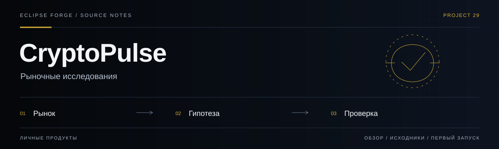

# CryptoPulse

<!-- project-links:start -->
[Открыть веб-версию](https://cryptopulse-1d0.pages.dev) · [Документация](docs/repository-guide.md) · [Код](https://github.com/PavelHopson/CryptoPulse/tree/main) · [История изменений](https://github.com/PavelHopson/CryptoPulse/commits/main/)
<!-- project-links:end -->



**Рыночные исследования.** Рабочее пространство для анализа крипторынка, сценариев и исследовательских гипотез.

<!-- eclipse-forge-projects:start -->
## Проекты Eclipse Forge

[Главная Eclipse Forge](https://eclipse-forge.ru/) · [Eclipse Library](https://library.eclipse-forge.ru/) · [Eclipse DnD Forge](https://dnd.eclipse-forge.ru/)

Исходный код: [Eclipse Forge Landing](https://github.com/PavelHopson/Eclipse-forge-website) · [Eclipse Chat](https://github.com/PavelHopson/eclipse-chat) · [Eclipse Library](https://github.com/PavelHopson/eclipse-library) · [Eclipse AI Hub](https://github.com/PavelHopson/eclipse-ai-hub) · [Eclipse Sentinel](https://github.com/PavelHopson/eclipse-hopson-sentinel) · [Eclipse Webclaw](https://github.com/PavelHopson/Eclipse-webclaw) · [Eclipse DnD Forge](https://github.com/PavelHopson/eclipse-dnd-forge) · [Finflow](https://github.com/PavelHopson/finflow) · [Eclipse Media](https://github.com/PavelHopson/eclipse-media) · [Shotforge](https://github.com/PavelHopson/shotforge) · [Text2Image](https://github.com/PavelHopson/Text2Image) · [Educator AI](https://github.com/PavelHopson/Educator-AI) · [@pavelhopson/retry-http](https://github.com/PavelHopson/retry-http)
<!-- eclipse-forge-projects:end -->

<!-- repository-guide:start -->
[Первый запуск](#readme-start) · [Что внутри](#readme-map) · [Путеводитель](docs/repository-guide.md#start) · [Карта кода](docs/repository-guide.md#map) · [Проверки](docs/repository-guide.md#checks) · [Границы и права](docs/repository-guide.md#boundaries)

<a id="readme-map"></a>

## Проект за минуту

- **[Лаборатория стратегий](<src/pages/StrategyLab.tsx>)** — Исследовательские сценарии и сравнение гипотез.
- **[Рыночные данные](<src/services/cryptoService.ts>)** — Интеграция получения и обработки данных.
- **[Доказательства стратегии](<src/services/strategyEvidence.ts>)** — Структура исследовательских результатов, не обещание доходности.

<a id="readme-start"></a>

## Начать локально

**Среда:** Node.js и npm. **Источник:** [package.json](<package.json>).

Из корня клонированного репозитория:

```bash
npm ci
npm run dev
```

Интерфейс и внешние AI-вызовы — разные этапы. До подключения провайдера проверьте настройки, стоимость и обработку ключей; значения секретов в README не размещаются.

<details>
<summary><strong>Перед первым запуском и изменением кода</strong></summary>

- Команды сверены с исходниками 8 сентября 2026. Это инструкция, а не отметка об успешном запуске или текущем production.
- Установка зависимостей может обращаться в registry и выполнять lifecycle scripts. Используйте отдельную рабочую среду и демонстрационные данные.
- Аналитика и paper trading не доказывают доходность. Подключение биржи и реальные сделки требуют отдельного решения.
- [ARCHITECTURE.md](<ARCHITECTURE.md>)

</details>
<!-- repository-guide:end -->

## Что это за проект?

**CryptoPulse Research Lab** — веб-платформа для исследования финансовых рынков, проверки торговых гипотез и paper trading с элементами AI-аналитики. Проект объединяет рыночные данные (CoinGecko API), ленту новостей через Cloudflare Worker и пользовательские AI-провайдеры.

Это **не биржа** и не инвестиционный советник — это инструмент для обучения, анализа и отработки торговых стратегий на виртуальном балансе без риска реальных денег.

**Ключевые возможности:**
- Котировки криптовалют от провайдера; форекс и фьючерсы помечаются как демонстрационные до подключения источника
- AI-анализ активов с явным указанием источника и ограничений
- Paper trading и воспроизводимые backtest-сценарии без broker connection и реальных ордеров
- Собственный парсер новостей (CoinTelegraph, CoinDesk, Investing.com)
- 3 темы оформления — Cyberpunk, Midnight (мягкая тёмная), Light (светлая)
- Strategy Lab — исторический paper backtest с комиссиями, slippage, Monte Carlo, walk-forward и независимыми ролями Optimist / Skeptic / Risk Manager; live orders отсутствуют

---

## Для кого этот проект?

<table>
<tr>
<td width="33%" valign="top">

### Начинающие исследователи
Хотите понять, как проверять рыночные гипотезы без риска для денег? CryptoPulse даёт учебные paper-сценарии, воспроизводимый backtest и отчёты, которые можно разбирать шаг за шагом.

</td>
<td width="33%" valign="top">

### Аналитики и исследовательские команды
Нужно сравнить активы и проверить гипотезу? Используйте рыночные данные, paper backtest и AI-разбор. Сервис не обещает доходность и не заменяет финансового консультанта.

</td>
<td width="33%" valign="top">

### Разработчики и студенты
Ищете пример современного React-приложения? Здесь: React 19, TypeScript, Vite 6, TailwindCSS, CSS-переменные для тем, Cloudflare Workers для парсинга, интеграция с 6 AI-провайдерами. Код открыт, MIT лицензия.

</td>
</tr>
</table>

---

## Коммерческая модель

### Модель монетизации

- **Free** — базовые котировки, избранное и ограниченный paper trading.
- **Pro** — история данных, Strategy Lab, воспроизводимые отчёты и AI-лимиты.
- **Team / School** — планируемый контур: группы, учебные сценарии, общий каталог исследований и админка.
- **White-label** — будущий отдельный бренд и домен для школы, сообщества или исследовательской команды.

Оплата, серверные аккаунты, синхронизация с Eclipse Library и общий облачный портфель пока находятся в разработке. Сейчас аккаунт и история исследований локальные. Реальные сделки, копи-трейдинг и торговые сигналы в коммерческий MVP не входят.

Подробный порядок внедрения: [коммерческий план](docs/commercial-roadmap.md).

### Конкурентные преимущества

- **AI-аналитик** — пользователь подключает СВОЮ модель (не платит нам за AI)
- **Без обязательного серверного запуска на старте** — локальные исследования работают в браузере, Worker подключается отдельно
- **Собственный парсер новостей** — не зависим от платных API
- **Три темы оформления** — Cyberpunk, Midnight и Light
- **Открытый код** — можно доработать под любые нужды
- **Простой запуск** — Cloudflare Pages и отдельный Worker; итоговая стоимость зависит от лимитов и трафика

---

## Возможности платформы

<div align="center">

|  |  |  |  |
|:---:|:---:|:---:|:---:|
| Данные с меткой источника | 6 AI-провайдеров | Paper trading | Исследовательские отчёты |

</div>

<table>
<tr>
<td width="50%">

### Рынки и аналитика
- Котировки **криптовалют** от CoinGecko с явной меткой источника и fallback-статусом
- Рынки **Форекс** и **Фьючерсов** (EUR/USD, Золото, S&P 500)
- **TradingView** свечные графики (OHLC)
- **Индикаторный обзор** — детерминированные учебные прокси по доступной цене и изменению за 24 часа; без исторического OHLC это не прогноз
- **Сравнение активов** — относительная динамика и изменение периода
- **Лента новостей** — парсинг CoinTelegraph, CoinDesk, Investing.com

</td>
<td width="50%">

### Исследования и сценарии
- **Strategy Lab** — воспроизводимый paper backtest без broker connection
- **Комиссии и slippage** — расчёт стоимости гипотезы
- **История paper-сценариев** — локальный отчёт, receipt и CSV экспорт
- **Профиль исследователя** — прогресс, избранное и быстрый переход к лаборатории

</td>
</tr>
<tr>
<td width="50%">

### AI и интеллект
- **6 провайдеров** — Gemini, OpenAI, Claude, OpenRouter, Ollama, **NVIDIA NIM**
- **Провайдер подключается явно** — через личный ключ в сессии или будущий серверный gateway; бесплатный доступ зависит от выбранного провайдера
- **Пользователь подключает свою модель** в настройках
- **Исследовательские выводы** — без обещаний доходности и без автоторговли
- **Контекст динамики** — нейтральное описание наблюдаемого движения и качества данных
- **Генерация отчётов** — профессиональный анализ по активу

</td>
<td width="50%">

### Платформа
- **Локальный профиль** — настройки и состояние текущего браузера
- **Strategy Lab** — backtest, Monte Carlo и walk-forward
- **3 темы** — Cyberpunk / Midnight / Light
- **Планируемые тарифы** — Free / Pro / Team / White-label
- **Мультиязычность** — Русский / English
- **Адаптивность** — Десктоп + Мобильная версия

</td>
</tr>
</table>

---

## Технологии

```
Фронтенд        React 19 + TypeScript + Vite 6
Стилизация       TailwindCSS 3 + CSS-переменные (3 темы)
Графики          Recharts + TradingView Lightweight Charts
AI               Gemini / OpenAI / Claude / OpenRouter / Ollama / NVIDIA NIM
Новости          Собственный парсер на Cloudflare Workers
Иконки           Lucide React
Роутинг          React Router v7
Состояние        localStorage для несекретных данных + sessionStorage для session/API key
Локальный пароль salted PBKDF2-HMAC-SHA256, 600 000 итераций
Тесты            Vitest + @testing-library/react + jsdom (unit, security и Strategy Lab проверки)
Деплой           Cloudflare Pages (фронт) + Workers (парсер)
```

Архитектура: смотри [ARCHITECTURE.md](./ARCHITECTURE.md) — диаграммы data flow, стратегия retry, провайдеры, стратегия тестирования.

## Дизайн-система

<table>
<tr>
<td align="center"><br/><code>#05000a</code><br/>Фон</td>
<td align="center"><br/><code>#00f3ff</code><br/>Циан</td>
<td align="center"><br/><code>#ff00aa</code><br/>Розовый</td>
<td align="center"><br/><code>#ff00ff</code><br/>Магента</td>
<td align="center"><br/><code>#fcee0a</code><br/>Жёлтый</td>
<td align="center"><br/><code>#00ff9d</code><br/>Зелёный</td>
</tr>
</table>

**Шрифты:** Orbitron (заголовки) + Rajdhani (текст) + JetBrains Mono (код)

**Эффекты:** CRT-сканлайны, фрактальный шум, неоновое свечение, кибер-карточки с угловыми акцентами

**3 темы оформления:**
| Тема | Описание |
|------|----------|
| **Cyberpunk** | Неоновый киберпанк — сканлайны, шум, свечение |
| **Midnight** | Мягкая тёмная — приглушённые цвета, приятная для глаз |
| **Light** | Светлая дневная — белый фон, чистый минимализм |

---

## Быстрый старт

```bash
# Клонировать
git clone https://github.com/PavelHopson/CryptoPulse.git
cd CryptoPulse

# Установить зависимости
npm install

# Запустить dev-сервер
npm run dev

# Собрать для продакшена
npm run build
```

### Переменные окружения (необязательно)

```bash
cp .env.example .env
```

| Переменная | Описание |
|------------|----------|
| `GEMINI_API_KEY` | Не встраивается в client build; AI-ключ задаётся только в сессии или через будущий server gateway |
| `VITE_NEWS_API` | URL парсера новостей (по умолчанию подключён наш Worker) |
| `VITE_AI_GATEWAY_MODE` | `client` по умолчанию; `server` включается только после production smoke server API |
| `VITE_AI_GATEWAY_URL` | URL server AI gateway; в client-режиме не используется |
| `VITE_RESEARCH_API_URL` | Пусто по умолчанию; при явной настройке включает авторизованную синхронизацию Strategy Lab через `/v1/research` |

> AI-функции работают без ключа — покажут сообщение с инструкцией. Пользователь может подключить свою модель в Настройки → AI.

### Деплой парсера новостей

```bash
cd workers/news-parser
npm install
npx wrangler login
npx wrangler deploy
```

### Будущий Research API

`workers/research-api/` содержит отдельный Cloudflare Worker для серверных
аккаунтов, сохранённых исследований и AI-прокси. Strategy Lab умеет подключаться
к нему только при явной настройке `VITE_RESEARCH_API_URL`; без переменной остаётся
локальным и не делает сетевых запросов. Worker не публикуется автоматически. Перед включением нужны D1,
production Rate Limiting binding, identity-сессии, CSRF-cookie, allowlist
моделей и upstream AI gateway. Полная последовательность и smoke-flow описаны
в `workers/research-api/README.md`.

---

## Структура проекта

```
src/
  App.tsx                    # Роутер и точка входа
  main.tsx                   # Рендер React DOM
  styles.css                 # Дизайн-система (CSS-переменные, 3 темы)
  types.ts                   # TypeScript интерфейсы + AI-конфигурация
  context/
    ThemeContext.tsx          # Контекст тем (Cyberpunk/Midnight/Light)
  components/
    Layout.tsx               # Главный лэйаут с навигацией и уведомлениями
    AIInsight.tsx             # AI-виджет анализа актива
    TradingViewChart.tsx      # Свечные графики OHLC
    SettingsModal.tsx         # Настройки (профиль, AI модель, безопасность)
    TechAnalysisModal.tsx     # Учебный обзор метрик и прокси без прогноза
    WalletModal.tsx           # Legacy local Web3-модалка; не подключена к Research Lab UI
  pages/
    Dashboard.tsx             # Обзор рынка (крипто/форекс/фьючерсы)
    CoinDetail.tsx            # Страница актива + график + AI
    Comparison.tsx            # Сравнение активов бок о бок
    Favorites.tsx             # Избранное / Watchlist
    Leaderboard.tsx           # Синтетические paper-сценарии и сравнение гипотез
    StrategyLab.tsx           # Paper backtest, CSV импорт и отчёты
    Profile.tsx               # Профиль исследователя и paper-режим
    PricingPage.tsx           # Тарифные планы
    LoginPage.tsx             # Авторизация (вход/регистрация)
    AdminPanel.tsx            # Локальная dev-панель (пользователи, конфиг, логи)
  services/
    aiService.ts              # Универсальный AI-сервис (6 провайдеров)
    cryptoService.ts          # CoinGecko API + статусы источника + OHLC fallback
    userService.ts            # Локальная авторизация и профиль
    newsService.ts            # Парсер новостей (Worker + RSS fallback)
    adminService.ts           # Конфигурация системы
    gamificationService.ts    # XP, уровни, достижения
    communityService.ts       # Данные лидерборда
    reportService.ts          # Отчёты по транзакциям (CSV)
    web3Service.ts            # Legacy local Web3 helpers; not mounted in the Research Lab UI
workers/
  news-parser/               # Cloudflare Worker — парсер новостей
    src/index.ts              # RSS парсер (CoinTelegraph, CoinDesk, Investing.com)
    wrangler.toml             # Конфигурация Cloudflare Worker
  research-api/              # Отдельный fail-closed Research Lab API (не deployed)
    src/index.ts              # Сессии, D1 research runs, AI boundary, quotas
    schema.sql                # D1 schema for research and usage ledger
    wrangler.toml             # Bindings and explicit production placeholders
```

## Лицензия

[MIT](LICENSE) — используйте свободно, коммерческое использование разрешено.

---

---

## Интеграции и Companion Tools

### Dexter — Deep Financial Research Agent

[Dexter](https://github.com/virattt/dexter) — автономный AI-агент для глубокого инвестиционного ресёрча. Дополняет встроенный AI-аналитик CryptoPulse:

| | CryptoPulse AI | Dexter |
|--|:---:|:---:|
| **Тип** | Быстрый обзор актива | Глубокий ресёрч с отчётностью |
| **Данные** | Цена, объём, новости | Income statements, balance sheets, cash flow |
| **Валидация** | Нет | Самопроверка каждой цифры |
| **Формат** | Инсайт в 1 клик | Многоступенчатый отчёт |
| **Провайдеры** | Gemini, OpenAI, Claude, Ollama | OpenAI, Anthropic, Google, Ollama |

**Как использовать вместе:**
1. CryptoPulse — мониторинг рынка, AI-разбор и paper backtest
2. Dexter — глубокий анализ перед принятием решения (финансовая отчётность, фактчекинг)

```bash
# Установка Dexter (TypeScript/Bun)
git clone https://github.com/virattt/dexter.git
cd dexter && bun install
cp .env.example .env  # Настроить API ключи
bun start
# Пример: "Summarize NVDA's observed market context for a paper research note"
```

### Roadmap: Deep Research Mode

В планах — интеграция Dexter-style глубокого анализа прямо в UI CryptoPulse:
- [ ] Кнопка "Глубокий анализ" на странице актива
- [ ] Финансовая отчётность (income statement, balance sheet, cash flow)
- [ ] Самовалидация AI-выводов перед отображением
- [ ] Сравнительный анализ нескольких активов

---

<div align="center">

**Создано с React 19 в эстетике Eclipse Forge**

<sub>CryptoPulse Research Lab — образовательный и исследовательский проект. Не является инвестиционной рекомендацией. Все сценарии paper-only.</sub>

</div>
